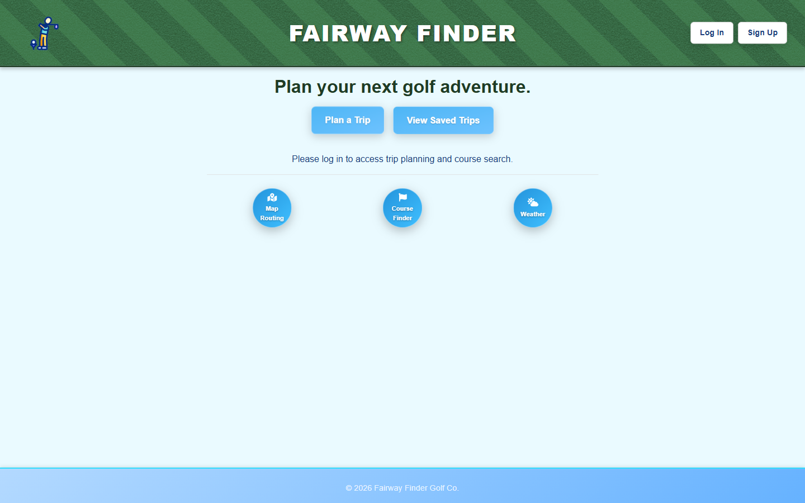
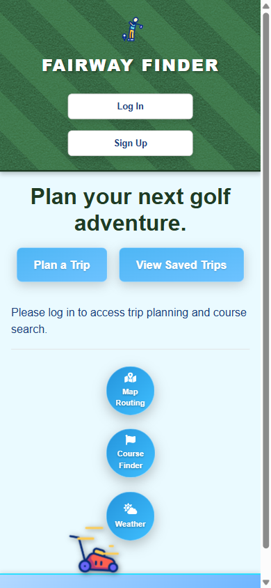

# 🏌️‍♂️ Fairway Finder

[](https://github.com/PHTMGatt/Fairway-Finder/actions/workflows/main.yml)
[](LICENSE)

A full-stack golf trip planner for small groups. Find courses, plan driving routes, check the forecast for your tee date, track your handicap, and keep scorecards for every round — in one phone-friendly app.

**Live:** [fairway-finder.onrender.com](https://fairway-finder.onrender.com) · Accounts are invite-only, but **Try as Guest** on the login page opens a 24-hour demo with no sign-up.

<p align="center">
  
  
</p>

---

## Features

- **Course finder** — search for courses, see tee boxes with course rating and slope, and save a course to a trip.
- **Trips and rounds** — plan a trip, add players, keep a scorecard per round, and review saved trips.
- **Directions** — driving routes with nearby stops along the way (Google Maps).
- **Weather** — forecast for the saved trip date, with °F / °C toggle (Open-Meteo, no API key needed).
- **Handicap tracker** — calculates a handicap index from live course rating and slope data and saves it to your profile.
- **Auth** — JWT sessions; email-code sign-up verification and password reset; invite-only registration; time-limited guest demo (24 h, capped trips, rate-limited, cleaned up automatically).
- **Phone-first UI** — responsive layout with a bottom navigation bar on small screens.

## Tech stack

| Layer | Tools |
|---|---|
| Client | React 18, TypeScript, Vite, React Router, Apollo Client, React-Bootstrap, `@vis.gl/react-google-maps` |
| Server | Node.js, Express, Apollo Server (GraphQL), Mongoose, JSON Web Tokens, Nodemailer |
| Data | MongoDB (Atlas in production), TTL indexes for guest cleanup |
| External APIs | Google Places / Routes / Geocoding and Maps JavaScript, GolfCourseAPI, Open-Meteo |
| Quality | ESLint, Node test runner (server), Vitest (client), GitHub Actions (lint, build, tests, security pipeline) |
| Hosting | Render |

Provider keys other than the browser Maps key stay on the server; the client talks to them through `/api/*` proxy routes that are rate limited.

## Getting started

**Prerequisites:** Node.js 22, a MongoDB connection string, and the API keys listed in [README_FairwayFinder_API_Setup.md](README_FairwayFinder_API_Setup.md).

```bash
git clone https://github.com/PHTMGatt/Fairway-Finder.git
cd Fairway-Finder
npm install            # installs root, client and server dependencies
```

Create `server/.env` and `client/.env` as described in the [API setup guide](README_FairwayFinder_API_Setup.md), then:

```bash
npm run build:dev      # build server and client, then run both in dev mode
```

The client runs on <http://localhost:3000> and the server on port 3001.

### Scripts

| Command | What it does |
|---|---|
| `npm run start:dev` | Run server and client with live reload |
| `npm run build` | Compile the server and build the client |
| `npm run lint` | ESLint over client and server source |
| `npm test` | Server tests (builds first) |
| `cd client && npx vitest run` | Client tests |
| `npm run invite` | Create a sign-up invite code (`--dry-run` supported; see `server/src/scripts/createInvite.ts`) |

## Security

Automated checks run on every push: lint, build, tests, and a layered security pipeline (low / medium / high) defined in [`.github/workflows`](.github/workflows). Findings and fixes are tracked in [SECURITY_REPORT.md](SECURITY_REPORT.md).

## Roadmap

- Sharing a trip with the group via a link
- Tee-time booking integration
- Installable PWA with offline support

## Credits

- **Primary developer:** [Bryen Gatt](https://github.com/PHTMGatt)
- **Contributors:** [Jarred Hampton](https://github.com/Jarred13D) · [Jared Owens](https://github.com/jaredowens) · [Hunter West](https://github.com/Frankthedestro) · [Nicholas Dear](https://github.com/n6dd)

## License

Released under the [MIT License](LICENSE).
